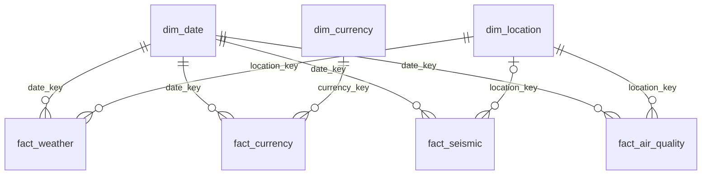

# Star Schema — Enterprise Open Data Platform

მოდელი აერთიანებს ამინდის, ვალუტის, მიწისძვრებისა და ჰაერის
დაბინძურების მონაცემებს analytics სქემაში.

## Dimension ცხრილები

| ცხრილი | ძირითადი გასაღები | ბუნებრივი გასაღები | დანიშნულება |
|---|---|---|---|
| dim_date | date_key — INT, YYYYMMDD | full_date | საერთო კალენდარი ოთხივე fact ცხრილისთვის |
| dim_location | location_key — SERIAL | city | საერთო ქალაქები ამინდის, მიწისძვრებისა და დაბინძურებისთვის |
| dim_currency | currency_key — SERIAL | code | ვალუტების ცნობარი |

## Fact ცხრილები

Grain განსაზღვრავს, რას წარმოადგენს ცხრილის ერთი ჩანაწერი.

| ცხრილი | Grain | დაკავშირებული dimension-ები |
|---|---|---|
| fact_weather | ერთი ქალაქის ამინდის ჩანაწერი კონკრეტულ დროს | dim_date, dim_location |
| fact_currency | ერთი ვალუტის კურსის ჩანაწერი კონკრეტულ დღეს | dim_date, dim_currency |
| fact_seismic | ერთი სეისმური მოვლენა | dim_date, dim_location |
| fact_air_quality | ერთი საწყისი გაზომვა კონკრეტულ ქალაქსა და დროს | dim_date, dim_location |

fact_seismic.location_key შეიძლება იყოს NULL, თუ მოვლენის
აღწერაში ქალაქის სახელი ვერ მოიძებნა. ქალაქი განისაზღვრება
place ველში სახელის ტექსტური ძებნით და არა გეოგრაფიული მანძილით.

fact_air_quality.measurement_id უნიკალურია და უკავშირდება
air_quality.measurements.id-ს, რაც იმავე გაზომვის განმეორებით
ჩატვირთვას გამორიცხავს.

## დროის დამუშავება

ამინდის, მიწისძვრებისა და ჰაერის დაბინძურების date_key
გამოითვლება Asia/Tbilisi დროის სარტყლით.

ვალუტის date_key გამოითვლება საწყისი rate_date თარიღიდან.

dim_date მოიცავს 2026-08-01–2026-09-30 პერიოდს, სულ 61 დღეს.
სხვა პერიოდის მონაცემების ჩატვირთვამდე კალენდარი უნდა გაფართოვდეს.

## ჰაერის დაბინძურების მონაცემები

ინახება PM2.5 და PM10 კონცენტრაციები µg/m³ ერთეულში.
source და data_kind სვეტები ინარჩუნებს მონაცემების წარმომავლობას.

მიმდინარე ოთხი გაზომვა ხელოვნური სასწავლო მონაცემია:
data_kind = synthetic.

## რატომ ეს დიზაინი

dim_date არის საერთო, conformed dimension ოთხივე მიმართულებისთვის.
dim_location საერთოა ამინდის, მიწისძვრებისა და ჰაერის
დაბინძურების მონაცემებისთვის.

სხვადასხვა fact ცხრილის შედარებამდე მონაცემები ცალ-ცალკე
ჯამდება საჭირო დონეზე, მაგალითად ქალაქისა და დღის მიხედვით.
შემდეგ ერთიანდება შეჯამებული შედეგები, რათა JOIN-მა
ჩანაწერები არ გაამრავლოს.

## შემოწმების შედეგები

| ცხრილი | ჩანაწერების რაოდენობა |
|---|---:|
| dim_date | 61 |
| dim_location | 5 |
| dim_currency | 5 |
| fact_weather | 24 |
| fact_currency | 23 |
| fact_seismic | 3 |
| fact_air_quality | 4 |

2026-08-27-ის საერთო მოთხოვნის შედეგი:

- თბილისის საშუალო ტემპერატურა: 24.45 °C.
- ერთი USD-ის კურსი: 2.6512 GEL.
- ჩატვირთული სეისმური მოვლენების რაოდენობა: 1.
- თბილისის საშუალო PM2.5: 12.63 µg/m³.
- თბილისის საშუალო PM10: 21.75 µg/m³.

დაბინძურების საშუალო ეფუძნება მხოლოდ ოთხ არსებულ საათობრივ
სასწავლო გაზომვას და არ წარმოადგენს სრული დღის საშუალოს.

## კავშირების დიაგრამა


## ცვლილებების ისტორია SCD Type 2

dim_location ინახავს მდებარეობის ისტორიულ ვერსიებს:

- valid_from — ვერსიის მოქმედების დასაწყისი, ჩათვლით.
- valid_to — მოქმედების დასასრული, ამ თარიღის გამოკლებით; მიმდინარე ვერსიისთვის NULL.
- is_current — მიმდინარე ვერსიის მაჩვენებელი.

საწყისი ქალაქების valid_from არის 2026-08-01. city ბუნებრივი გასაღებია,
თუმცა ისტორიულ ვერსიებში მეორდება. ნაწილობრივი უნიკალური ინდექსი
თითო ქალაქისთვის მხოლოდ ერთ მიმდინარე ვერსიას უშვებს.
თითო ისტორიულ ვერსიას თავისი location_key უნდა ჰქონდეს.

არსებული fact ჩანაწერები ინარჩუნებს ჩატვირთვისას მინიჭებულ location_key-ს.
ისტორიის დამატების შემდეგ ახალი fact ჩანაწერის ჩატვირთვისას მდებარეობის
ვერსია უნდა შეირჩეს ქალაქისა და მოვლენის ადგილობრივი თარიღით:
valid_from <= event_date და (valid_to IS NULL ან event_date < valid_to).
მხოლოდ ქალაქის სახელით JOIN ისტორიული ვერსიების არსებობისას ჩანაწერებს გაამრავლებს.

src/modeling/scd2.py არის Python-ის მეხსიერებაში მოქმედი სასწავლო ფუნქცია.
იგი ბაზაში ვერსიებს არ წერს და location_key-ს არ ანიჭებს.
ტესტები ამოწმებს პირველ ვერსიას, უცვლელ მონაცემსა და ნამდვილ ცვლილებას.
თარიღები გადაეცემა YYYY-MM-DD ფორმატით.

ტესტების გაშვება პროექტის მთავარი საქაღალდიდან:

```bash
python3 src/modeling/scd2.py
```

მოსალოდნელი ბოლო შეტყობინება: All 3 tests passed.

## AI Corner — დამოუკიდებელი დიზაინის შეფასება

AI-ს დამოუკიდებლად ვთხოვეთ ამინდის, ვალუტის, მიწისძვრებისა და ჰაერის
დაბინძურების ერთობლივი ანალიზისთვის მოდელის შემოთავაზება.

| კრიტერიუმი | AI-ის პასუხი | შედარება ჩვენს მოდელთან |
|---|---|---|
| საერთო კალენდარი | ოთხივე fact-ისთვის საერთო DimDate | ემთხვევა ჩვენს conformed dim_date-ს |
| საერთო ქალაქები | DimCity, მუდმივი city_id და ვერსიის city_key | ჩვენი dim_location ქალაქის სახელზეა დაფუძნებული; მუდმივი city_id გააუმჯობესებდა სახელის ცვლილების დამუშავებას |
| ისტორიის შენახვა | SCD Type 2, მოქმედების ინტერვალები და მოვლენის დროით ვერსიის არჩევა | შეესაბამება ჩვენს SCD2 მიზანს; ჩვენი Python ფუნქცია მხოლოდ მეხსიერებაში დემონსტრაციაა |
| JOIN-ის სისწორე | fact-ების ცალ-ცალკე შეჯამება და შემდეგ შეერთება | ემთხვევა ჩვენს ყოველდღიურ ანალიტიკურ მოთხოვნას |
| ჰაერის დაბინძურება | ერთი ჩანაწერი სადგურზე, დამაბინძურებელზე, ინტერვალსა და წყაროზე | ჩვენ PM2.5 და PM10 ერთ ჩანაწერში გვაქვს, რადგან საწყისი მონაცემები ასეა ორგანიზებული |
| დამატებითი განზომილებები | DimTime, DimStation, DimPollutant, DimSource | გაფართოებისთვის გამოსადეგია, მაგრამ მიმდინარე მცირე მონაცემებისთვის ყველა აუცილებელი არ არის |
| მიწისძვრა და ქალაქი | მრავალი ქალაქის დასაკავშირებელი ხიდი და გეოგრაფიული მანძილი | ჩვენ ვიყენებთ place ტექსტში ქალაქის ძებნას; ეს გეოგრაფიულ სიახლოვეს არ ადგენს |

AI-ის პასუხი ძირითად მოთხოვნებს აკმაყოფილებს, თუმცა მისი ყველა ნაწილი
პირდაპირ დანერგვას არ საჭიროებს. ჩვენს წყაროში სადგურის იდენტიფიკატორი არ
არის, ამიტომ სადგურებზე დაფუძნებული grain დამატებით წყაროს ან გარკვეულ
შესაბამისობის წესს მოითხოვს. ჩვენს ამინდის მონაცემებს forecast_time აქვს,
ამიტომ პროგნოზის დროისა და ფაქტობრივი დაკვირვების დროის მნიშვნელობა უნდა
გავარჩიოთ. GEL-ზე ფიქსირებული კურსისთვის ქალაქისა და ვალუტის ხიდი მიმდინარე
ანგარიშს არ სჭირდება; იგი შეიძლება საჭირო გახდეს სხვა ბიზნესმოთხოვნისას.

დროის დამუშავებისას ფაქტის date_key უნდა ეფუძნებოდეს შეთანხმებულ წესს.
ჩვენი მიმდინარე ქართული ქალაქებისთვის ვიყენებთ Asia/Tbilisi-ს. სხვადასხვა
დროის სარტყლის მქონე ქალაქებზე გაფართოებისას UTC და ადგილობრივი დღის
დაჯგუფება ცალსახად უნდა განისაზღვროს.

შეფასების მთავარი კრიტერიუმია მოდელის შესაბამისობა ჩვენს ანალიტიკურ
კითხვებთან და მონაცემების grain-თან. მხოლოდ სწორი SQL სინტაქსი ვერ
უზრუნველყოფს სწორ დათვლებს, დროით შესაბამისობასა და ისტორიის შენარჩუნებას.
